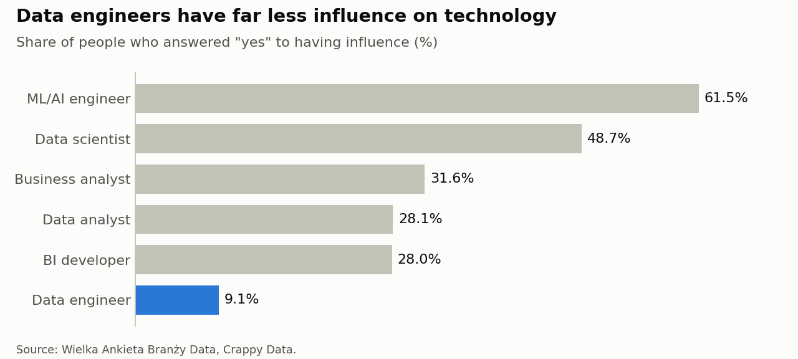
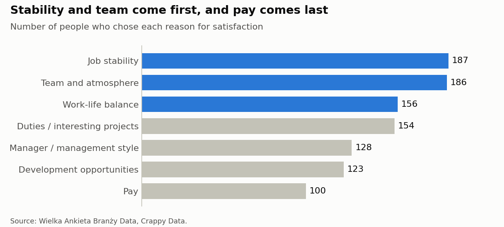

# What Really Matters in Data Jobs?

Do people who work longer earn more? Is pay the main reason people like their job? This project tests 11 comparisons with survey answers from 297 data professionals, to separate strong results from differences that may come from chance.

**[Open the full analysis](data_jobs_survey.ipynb)**



## Main results

- **Project work and satisfaction:** people with regular or partial project work have a mean satisfaction of 7.04 out of 10. People with little or no project work have a mean of 5.93 (p < 0.001).
- **Influence on technology:** only 9.1% of data engineers say that they influence technology choices, compared with 33.5% of everyone else (p = 0.004).
- **Reasons for satisfaction:** job stability, team and atmosphere, and work-life balance are the top reasons. Pay comes last.
- **Pay differences:** men, people who work 9-10 hours and people with more experience have higher average or median pay in this sample, but these differences could come from chance.
- **Education:** a degree is common in every position, but in most positions fewer than 1 in 4 people studied computer science.

Only 2 of the 11 comparisons pass a strict test for multiple comparisons. These results describe connections in this sample, not causes.



## Data

The data comes from **Wielka Ankieta Branży Data** (Great Data Industry Survey), created by **Crappy Data**. It has 297 people and 7 connected tables about work, teams, tools, pay, well-being and future plans.

Pay means average monthly take-home pay ("na rękę") in PLN. People were expected to divide their yearly income by 12, after all taxes and social contributions (ZUS). The survey author cannot guarantee that everyone calculated it in exactly this way.

**The raw data is not in this repository**, because the data rules do not allow publishing it. The project shows only group results and hides groups with fewer than 5 people.

## Methods

- Python: pandas, SciPy and Matplotlib
- Tests: Mann-Whitney U, Kruskal-Wallis, Fisher's exact and chi-square
- Bonferroni correction for multiple comparisons

## Project structure

```text
data-jobs-survey/
├── data_jobs_survey.ipynb    Full analysis with results
├── images/                   Charts from the notebook
├── requirements.txt          Python packages
└── README.md
```

## How to run it

You can read the notebook and its results on GitHub without running anything.

To run it again, you need your own access to the survey data. Put the CSV files in a `data` folder next to the project folder:

```text
your-folder/
├── data/                     Survey CSV files (not in this repository)
└── data-jobs-survey/
```

Then install the packages and open the notebook:

```bash
pip install -r requirements.txt
jupyter notebook data_jobs_survey.ipynb
```

## Source

Źródło: Wielka Ankieta Branży Data, Crappy Data.
